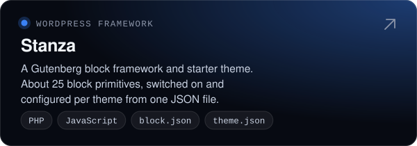
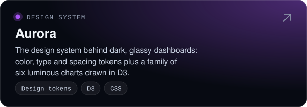
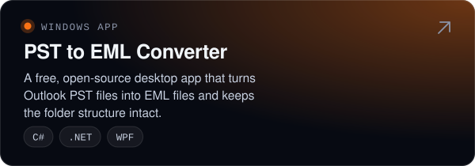
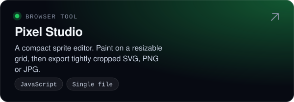
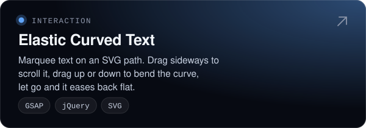
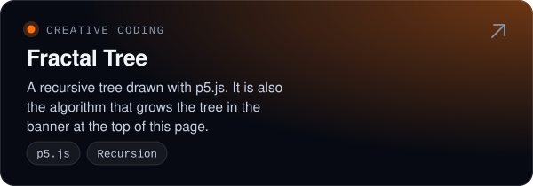

  
  
  
  

## Hello

I'm Konstantinos, a software engineer and systems administrator at [Beetroot](https://github.com/beetroot-studio) in Thessaloniki. I work across the whole stack: the interface people touch, the backend behind it, and the servers that keep it running.

Most of my client work lives in private repositories. What you see here is the part I can share: frameworks I build on, small tools that solved a real problem once, and creative-coding sketches I make for fun.

## Selected work

  
  

  
  

  
  

**More sketches:** [ASCII art generator](https://github.com/kgounaris/ASCII-art-generator) · [Interactive grid](https://github.com/kgounaris/interactive-grid) · [DVD animation](https://github.com/kgounaris/DVD-Animation) · [JS poker](https://github.com/kgounaris/Js-Poker) · [Flood fill](https://github.com/kgounaris/floodfill)

**Small tools and guides:** [FFmpeg batch resizer](https://github.com/kgounaris/ffmpeg_resize_convert_bat) · [ImageMagick image resizer](https://github.com/kgounaris/image-resizer-with-image-magick) · [SCSS flex grid with masonry](https://github.com/kgounaris/scss-flex-grid-and-masonry) · [Unreal Engine file dialog](https://github.com/kgounaris/unreal-engine-file-dialog-opener) · [Webmin + Virtualmin on Ubuntu](https://github.com/kgounaris/webmin-virtualmin-installation-guide-on-ubuntu-vps) · [HTML signatures in Apple Mail](https://github.com/kgounaris/add-html-signature-to-macmail)

## Toolbox

<table>
  <tr>
    <td><b>Interface</b></td>
    <td>
      
      
      
      
      
      
      
    </td>
  </tr>
  <tr>
    <td><b>Backend</b></td>
    <td>
      
      
      
      
      
      
      
    </td>
  </tr>
  <tr>
    <td><b>Infrastructure</b></td>
    <td>
      
      
      
      
      
      
    </td>
  </tr>
</table>

## Contributions

<picture>
  <source media="(prefers-color-scheme: dark)" srcset="https://raw.githubusercontent.com/kgounaris/kgounaris/output/github-snake-dark.svg">
  
</picture>

The tree in the banner is an animated SVG generated with the same recursion as <a href="https://github.com/kgounaris/Fractal-Tree">Fractal-Tree</a>.

